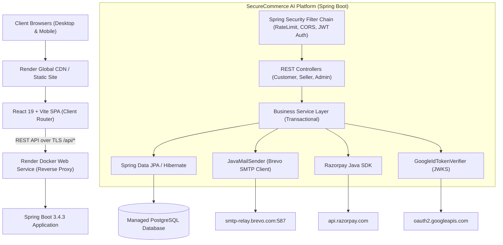
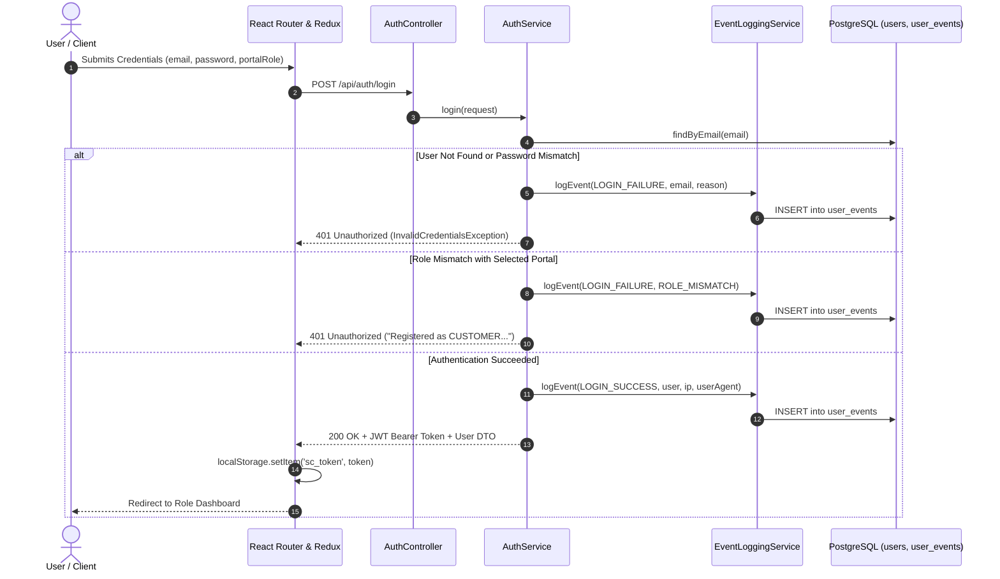
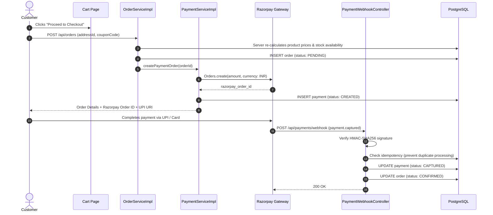
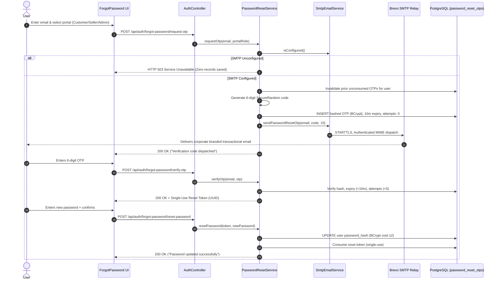
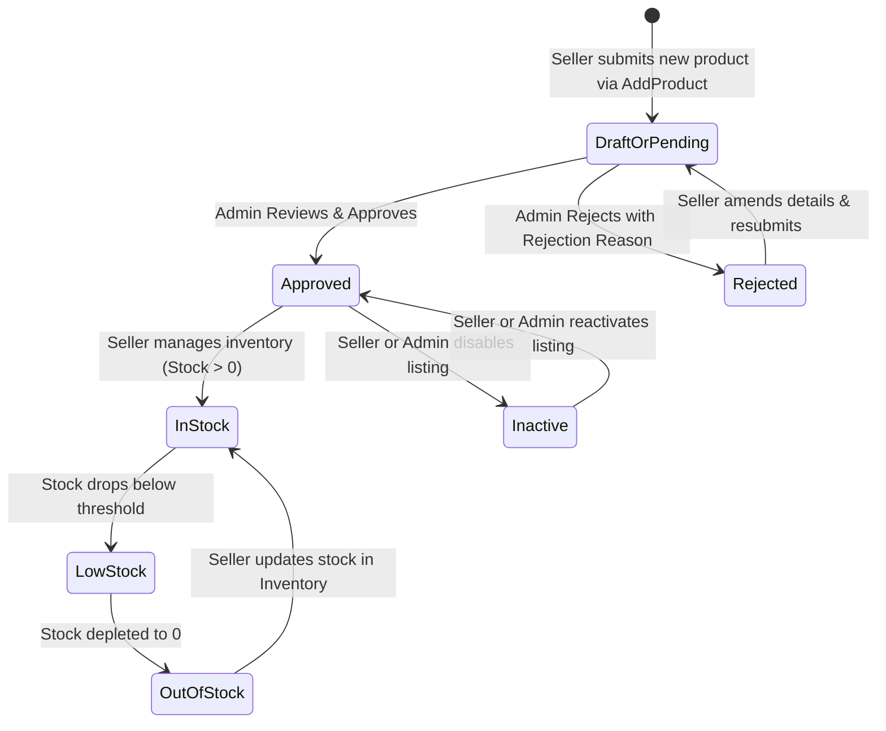
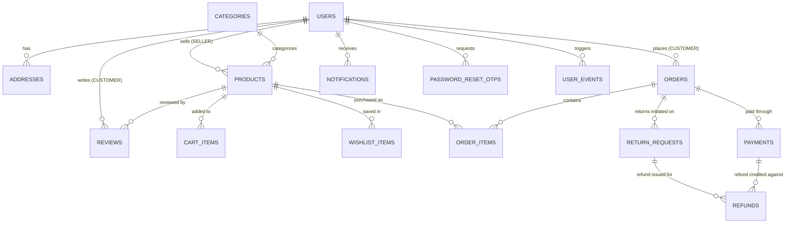

# SHOPIVO Full System Architecture

**Project:** SHOPIVO — A New Era of Shopping  
**Architecture Specification Document (Semester 1 & 2)**  
**Version:** 1.0.0 (Production-Ready Multi-Vendor Architecture)

---

## 1. Project Overview & Business Objectives

SHOPIVO is a multi-vendor e-commerce platform built to demonstrate enterprise architecture, clean role-based boundaries, server-authoritative transactions, and fraud resilience. 

### Core Business Objectives:
- **True Multi-Tenancy for Sellers:** Independent storefronts with segregated order fulfillment, catalog administration, inventory control, and revenue analytics.
- **Customer Security & Trust:** Cryptographic authentication, zero client-side price tampering, secure Razorpay payments, verified purchase reviews, and transparent return/refund workflows.
- **Unified Governance for Administrators:** Centralized product moderation, dispute handling, user verification, and activity telemetry.
- **CyberForge Design Language:** High-contrast, accessibility-focused interface utilizing `#050505` black canvas, `#101010` card elements, and `#04DB7E` emerald accents.

---

## 2. High-Level System Architecture



---

## 3. Authentication & Authorization Architecture

SHOPIVO implements a unified security model that enforces strict role-based access control across all operations:



---

## 4. Complete Workflow Diagrams

### A. Cart-to-Checkout & Razorpay Payment Workflow



---

### B. Forgot Password & Brevo SMTP OTP Workflow



---

### C. Multi-Seller Product Lifecycle



---

## 5. Main Database Entity Relationships



---

## 6. Security, Rate Limiting & Error Architecture

1. **Defense in Depth:**
   - **Frontend:** Client-side sanitization, Redux state encapsulation, route guard layers (`ProtectedRoute`, `RoleRoute`).
   - **Gateway / Transport:** TLS termination, Render reverse proxy headers, strict CORS policy (`http://localhost:5173`, `https://*.onrender.com`).
   - **API Layer:** `RateLimitingFilter` enforces a token-bucket algorithm (maximum 10 login attempts per minute, 5 registrations per minute per IP address).
   - **Data Layer:** Server-authoritative calculations, BCrypt cost-12 password hashing, parameterized JPA queries preventing SQL injection, Hibernate entity validation (`ddl-auto: validate`).

2. **Standardized Error Envelope:**
   All errors resolve through `GlobalExceptionHandler` returning a uniform structure:
   ```json
   {
     "success": false,
     "message": "Human-readable error explanation",
     "timestamp": "2026-11-11T02:00:00Z",
     "errorCode": "INVALID_CREDENTIALS"
   }
   ```

