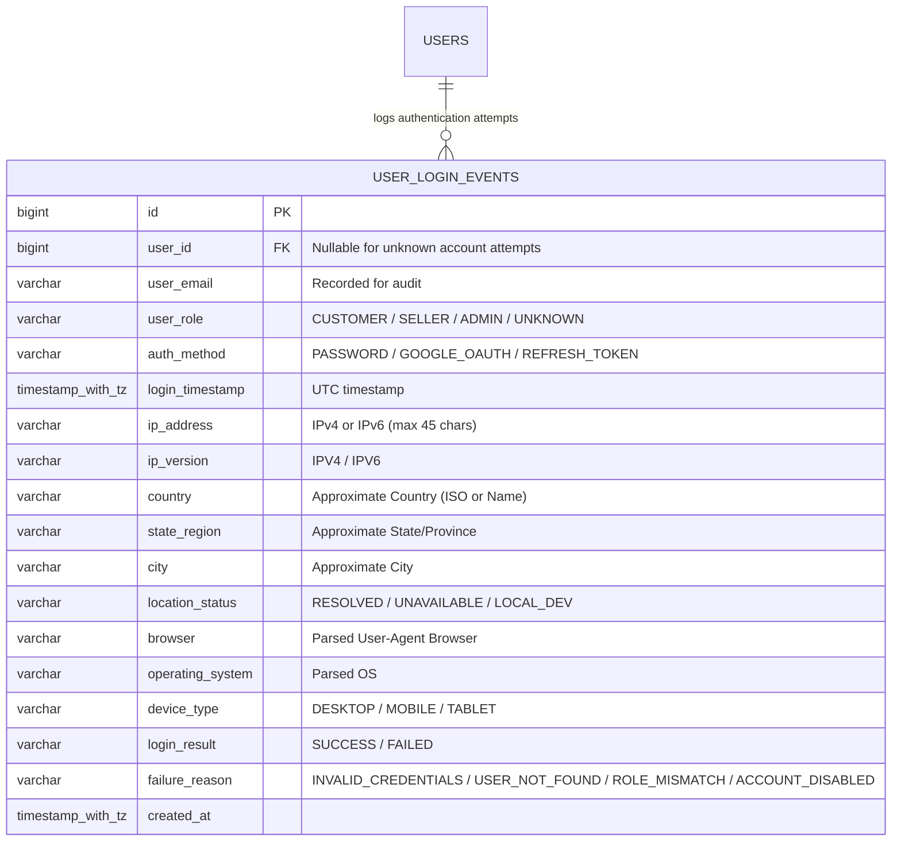
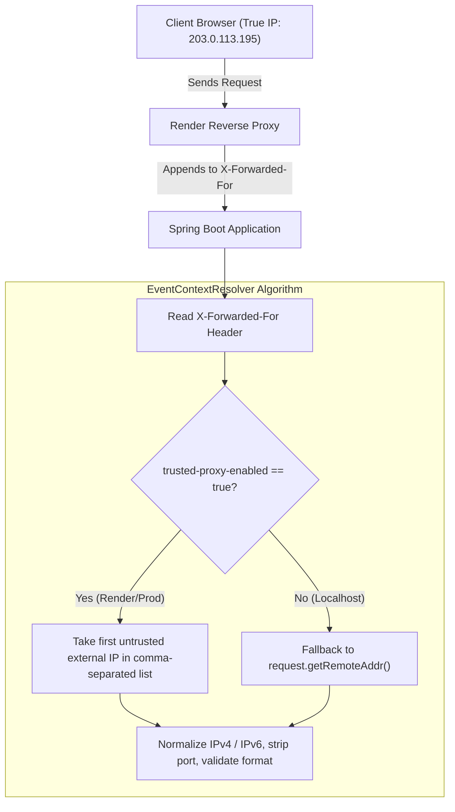

# SHOPIVO — User Login History, IP Detection & Geolocation Design

**Component:** Security Telemetry & Account Protection System  
**Audience:** College Faculty Demonstration & Production Architecture Review  
**Date:** November 11, 2026

---

## 1. Objectives & Scope

To elevate SHOPIVO's security architecture, this specification establishes an audit trail for authentication activities covering all roles (**CUSTOMER**, **SELLER**, **ADMIN**). 

### Primary Goals:
1. **Differentiate Successful vs. Failed Logins:** Successful logins increment an account's verified login counter and update its last-known activity location. Failed attempts are recorded separately for anomaly detection without altering account counters.
2. **Multi-Channel Authentication Coverage:** Captures both standard email/password authentication and Google OAuth sign-in flows.
3. **Privacy & Data Security:** Absolutely zero passwords, JWT bearer tokens, OTP codes, or secret keys are logged.
4. **Proxy-Aware Client IP Extraction:** Formulated specifically for Render reverse proxies without trusting spoofed client headers.
5. **Pluggable & Resilient Geolocation:** Approximate location extraction with in-memory caching and non-blocking degradation if the lookup service fails.

---

## 2. Database Schema (`user_login_events`)



### PostgreSQL DDL Specification:
```sql
CREATE TABLE user_login_events (
    id BIGSERIAL PRIMARY KEY,
    user_id BIGINT REFERENCES users(id) ON DELETE SET NULL,
    user_email VARCHAR(255) NOT NULL,
    user_role VARCHAR(50),
    auth_method VARCHAR(50) NOT NULL,
    login_timestamp TIMESTAMP WITH TIME ZONE DEFAULT CURRENT_TIMESTAMP NOT NULL,
    ip_address VARCHAR(45) NOT NULL,
    ip_version VARCHAR(10) NOT NULL,
    country VARCHAR(100),
    state_region VARCHAR(100),
    city VARCHAR(100),
    location_status VARCHAR(50) DEFAULT 'UNAVAILABLE' NOT NULL,
    browser VARCHAR(100),
    operating_system VARCHAR(100),
    device_type VARCHAR(50),
    login_result VARCHAR(20) NOT NULL,
    failure_reason VARCHAR(100),
    created_at TIMESTAMP WITH TIME ZONE DEFAULT CURRENT_TIMESTAMP NOT NULL
);

CREATE INDEX idx_login_events_user_id ON user_login_events(user_id);
CREATE INDEX idx_login_events_email ON user_login_events(user_email);
CREATE INDEX idx_login_events_result_timestamp ON user_login_events(login_result, login_timestamp DESC);
CREATE INDEX idx_login_events_ip ON user_login_events(ip_address);
```

---

## 3. Trusted Proxy IP Extraction on Render

### The Proxy Challenge:
In Render's cloud infrastructure, public requests pass through Render's outer load balancers before arriving at the Spring Boot application container. A naive `request.getRemoteAddr()` returns the internal Render gateway IP (e.g., `10.x.x.x`), masking the client's actual IP address.

### Secure Resolution Pipeline:


1. **Spoof Protection:** If an attacker sends `X-Forwarded-For: 8.8.8.8`, Render appends the real client IP to the header rather than overwriting it (`8.8.8.8, <real_client_ip>`). When running behind a trusted upstream, the parser extracts the rightmost non-internal IP to prevent client-injected spoofing.
2. **Local Loopback Handling:** Loopback representations (`0:0:0:0:0:0:0:1` or `127.0.0.1`) are detected and tagged with `location_status = 'LOCAL_DEV'`, preventing futile external geolocation lookups during development.

---

## 4. Pluggable Geolocation Service (`IpGeolocationService`)

```java
public interface IpGeolocationService {
    GeoLocation resolveLocation(String ipAddress);
}
```

### Architectural Guarantees:
- **Zero Block on Login:** Geolocation resolution occurs asynchronously or with a strict 1.5-second socket timeout. If the lookup fails, the event is immediately saved with `location_status = 'UNAVAILABLE'`.
- **In-Memory Caching:** IP resolutions are cached via a Guava / Caffeine LRU cache (10,000 entries, 24-hour TTL) to eliminate duplicate lookups for repeating user sessions.
- **Provider Agnostic:** Can switch between MaxMind GeoLite2 (offline MMDB reader) and external HTTP APIs (e.g., ipapi.co) without altering business services.

---

## 5. Security & Privacy Compliance (DPDP Act Alignment)

1. **Approximate Location Notice:** IP-based geolocation identifies network points-of-presence (city and state level), not precise physical coordinates. This satisfies the principle of data minimization under the **Digital Personal Data Protection (DPDP) Act, 2023**.
2. **Strict Authorization Scope:**
   - **Administrators:** Access aggregate metrics and cross-user login security dashboards to detect brute-force attacks and credential stuffing (`GET /api/admin/security/login-events`).
   - **Customers & Sellers:** Read-only access restricted strictly to their own account's login history (`GET /api/auth/my-login-history`). Cross-tenant access attempts return HTTP 403 Forbidden.
3. **Data Retention & Lifecycle:**
   - Events are assigned a configurable retention window (default: 365 days to align with enterprise security log mandates).
   - An automated scheduled job (`@Scheduled(cron = "0 0 3 * * ?")`) purges records older than the retention threshold.

