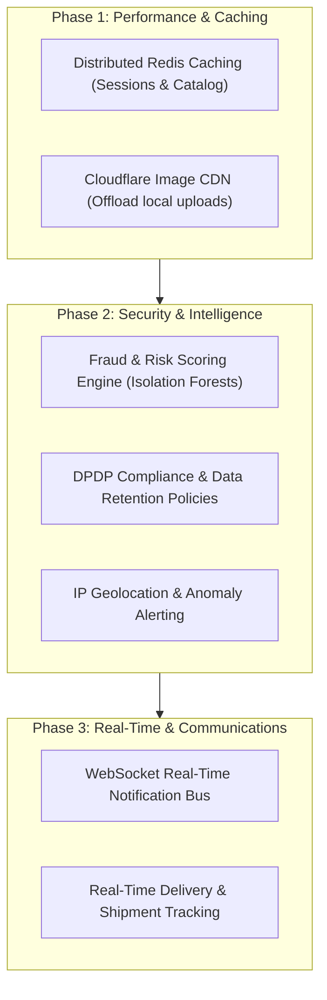

# SHOPIVO — Semester 2 Architectural Roadmap

**Platform:** SHOPIVO Multi-Vendor E-Commerce Platform  
**Target:** Advanced Production Scalability, Intelligence & Resilience  
**Date:** November 11, 2026

---

## 1. Architectural Readiness Evaluation

Following the successful completion of the Semester 1 deliverables (Multi-Role Authentication, Dynamic Marketplace Catalog, Multi-Seller Order Fulfillment, Razorpay Payments, Brevo SMTP OTP Delivery, and Admin Governance), the system is prepared to scale.

### Current Strengths:
- Fully normalized PostgreSQL database schema managed through Flyway version control.
- Clean separation of concerns between Controllers, DTOs, Services, and JPA Repositories.
- Server-authoritative checkout and payment verification pipelines.
- Modern React 19 single-page architecture styled with Tailwind CSS.

---

## 2. Semester 2 Priority Enhancements

---

## 3. Semester 2 Module Implementation Matrix

| Milestone | Capability / Feature | Technical Dependencies | Complexity | Priority | Acceptance Criteria |
|---|---|---|:---:|:---:|---|
| **M1: Cloud Media Storage** | S3 / Cloudflare R2 Product Image Storage | AWS SDK / MinIO Client | Medium | High | Replace local disk storage (`uploads/`) with pre-signed CDN URLs; sub-100ms image load times globally. |
| **M2: Distributed Caching** | Redis Cache for Categories & Top Products | `spring-boot-starter-data-redis` | Medium | High | Cache hits for `/api/categories` and `/api/products` (p95 latency < 15ms). Auto-eviction on product edit. |
| **M3: Fraud Scoring Engine** | ML Anomaly Detection on Checkout & Login | Python Sidecar / ONNX Java Runtime | High | Critical | Real-time trust score computation (0-100) analyzing order velocity, device fingerprint, and IP anomalies. |
| **M4: Real-Time Telemetry** | WebSockets for Order & Notification Stream | Spring WebSocket STOMP | Medium | Medium | Immediate notification badge updates and seller order alerts without client-side polling. |
| **M5: DPDP Act Compliance** | Right to be Forgotten & Privacy Vault | Spring Batch / Flyway | High | High | User account deletion cascade with financial audit anonymization; exportable personal data package. |
| **M6: Full-Text Search** | Elasticsearch / OpenSearch Integration | Spring Data Elasticsearch | High | Medium | Fuzzy spell-correction, facet filtering across 10,000+ products with sub-30ms response times. |
| **M7: Automated CI/CD** | GitHub Actions Pipeline with Auto-Staging | Docker, Render Webhooks, SonarQube | Low | Medium | Automated test execution, vulnerability scanning, and non-destructive deployment upon merging to `main`. |

---

## 4. Testing & Verification Roadmap for Semester 2

1. **Load & Concurrency Testing:** Simulate 500 concurrent checkout attempts using JMeter/Gatling to ensure zero double-spending or stock overselling.
2. **Chaos Engineering:** Inject artificial network delays and database failovers to verify that Razorpay webhook retries and transactional rollbacks operate idempotently.
3. **End-to-End Cypress / Playwright Suites:** Implement visual regression and browser automation covering Customer, Seller, and Admin workflows on desktop and mobile viewports.

