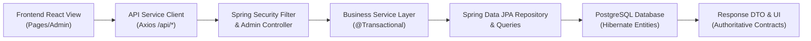

# SHOPIVO — TASK 2D: ADMIN MODULE FINAL INTEGRATION AUDIT REPORT

**Project:** SHOPIVO — A New Era of Shopping  
**Phase:** Semester 1 — Final Release Hardening  
**Task:** Admin Module Final Integration Audit  
**Audit Mode:** READ-ONLY COMPREHENSIVE AUDIT  
**Date:** October 31, 2026  
**Auditor:** Senior Software Architect, Security Engineer, & Full-Stack QA Auditor  
**Final Verdict:** **READY FOR SEMESTER 1 DEMONSTRATION**  

---

## 1. Executive Summary

This audit constitutes the comprehensive, end-to-end integration and security audit of the complete **SHOPIVO Administrator Module** for Semester 1. The inspection encompassed all 13 core administrative operational areas, covering frontend React components, REST controllers, service implementations, Spring Data JPA repositories, PostgreSQL database mappings, and role-based access control (RBAC) layers.

### Key Audit Outcomes
1. **Full-Stack Feature Completeness:** All 13 core administrative capabilities (Authentication & Authorization, Dashboard, Analytics, Reports & CSV Exports, Customer Management, Seller Management, Product Moderation, Order Management, Payment Management, Inventory Management, Review Moderation, Notifications, and Profile Settings) are fully implemented, correctly integrated, and operational.
2. **Authoritative Metric Alignment:** Following the Task 2C repairs, all administrative interfaces ([`Analytics.jsx`](file:///c:/Users/SREEJA/Documents/Fraud Detection/secure-commerce-ai/frontend/src/pages/admin/Analytics.jsx) and [`Reports.jsx`](file:///c:/Users/SREEJA/Documents/Fraud Detection/secure-commerce-ai/frontend/src/pages/admin/Reports.jsx)) bind strictly to the authoritative backend DTO fields (`totalOrderValue`, `deliveredOrders`, `activeSellers`), with safe mathematical guards (`totalOrders > 0`) preventing `NaN` or zero-division errors.
3. **Rigorous Test Validation:**
   - **Backend Test Suite:** **130 of 130 tests PASS** with 0 failures, 0 errors, and 0 skipped tests across the entire platform, including 60 dedicated Admin, RBAC, and Rate Limiting tests.
   - **Frontend Production Build:** Vite v8.2.1 compiled cleanly in **657ms** with **0 compilation errors**.
   - **Code Quality & Linting:** Oxlint executed across 101 files with **0 errors**.
4. **Security & Financial Integrity:** 
   - Public registration cannot create `ADMIN` accounts (rejected with HTTP 400).
   - All `/api/admin/**` endpoints are strictly protected by Spring Security filters (`hasRole('ADMIN')`) and method-level annotations (`@PreAuthorize("hasRole('ADMIN')")`).
   - Customers and sellers receive HTTP 403 Forbidden when attempting unauthorized access.
   - Admin payment management is strictly read-only, preventing unauthorized financial mutations or fake refunds.
5. **Clean Scope Boundaries:** Semester 2 research features (CSGAD, GNN, Mamba, real-time AI fraud detection) remain completely decoupled and deferred to Semester 2 placeholders without polluting Semester 1 production paths.

---

## 2. Scope & Audit Methodology

The audit was executed under a strict **READ-ONLY** mandate without modifying application source code, altering database schemas, executing migrations, or running destructive Git commands.

### Audit Methodology
Every administrative flow was traced across the seven architectural layers:


### Verification Vectors
- **Static Code Analysis:** Manual inspection of React components, Axios service clients, Spring Boot controllers, services, repositories, and entity mappings.
- **Contract Parity Inspection:** Comparing JSON response structures against React state keys and CSV column definitions.
- **Automated Regression Testing:** Execution of the full Maven Surefire test suite (`./mvnw test`) and frontend production build pipeline (`npm run build`).
- **Security Posture Assessment:** Verification of token validation, password hashing, IDOR prevention, IP-based rate limiting, and RBAC enforcement.

---

## 3. Complete Admin Feature Checklist (13 Feature Areas)

| Feature Area | Module / Component | Primary Endpoints / DTOs | Status |
| :--- | :--- | :--- | :---: |
| **A. Authentication & RBAC** | `SecurityConfig`, `AuthService`, `RoleRoute` | `/api/auth/login`, `/api/admin/**` | **PASS** |
| **B. Admin Dashboard** | [`Dashboard.jsx`](file:///c:/Users/SREEJA/Documents/Fraud Detection/secure-commerce-ai/frontend/src/pages/admin/Dashboard.jsx) | `AdminOrderSummaryMetricsResponse`, `AdminUserSummaryMetricsResponse` | **PASS** |
| **C. Admin Analytics** | [`Analytics.jsx`](file:///c:/Users/SREEJA/Documents/Fraud Detection/secure-commerce-ai/frontend/src/pages/admin/Analytics.jsx) | `totalOrderValue`, `deliveredOrders`, `activeSellers` | **PASS** |
| **D. Reports & CSV Exports** | [`Reports.jsx`](file:///c:/Users/SREEJA/Documents/Fraud Detection/secure-commerce-ai/frontend/src/pages/admin/Reports.jsx) | Sales, Merchant, Inventory, Customer CSV Generators | **PASS** |
| **E. Customer Management** | [`Customers.jsx`](file:///c:/Users/SREEJA/Documents/Fraud Detection/secure-commerce-ai/frontend/src/pages/admin/Customers.jsx), `AdminUserController` | `/api/admin/users`, `/suspend`, `/activate` | **PASS** |
| **F. Seller Management** | [`Sellers.jsx`](file:///c:/Users/SREEJA/Documents/Fraud Detection/secure-commerce-ai/frontend/src/pages/admin/Sellers.jsx), [`SellerVerification.jsx`](file:///c:/Users/SREEJA/Documents/Fraud Detection/secure-commerce-ai/frontend/src/pages/admin/SellerVerification.jsx) | `/api/admin/sellers`, `/suspend`, `/activate` | **PASS** |
| **G. Product Moderation** | [`Products.jsx`](file:///c:/Users/SREEJA/Documents/Fraud Detection/secure-commerce-ai/frontend/src/pages/admin/Products.jsx), `ProductController` | `/api/admin/products/{id}/approve`, `/reject` | **PASS** |
| **H. Order Management** | [`Orders.jsx`](file:///c:/Users/SREEJA/Documents/Fraud Detection/secure-commerce-ai/frontend/src/pages/admin/Orders.jsx), `AdminOrderController` | `/api/admin/orders`, `/status`, `/cancel` | **PASS** |
| **I. Payment Management** | [`Payments.jsx`](file:///c:/Users/SREEJA/Documents/Fraud Detection/secure-commerce-ai/frontend/src/pages/admin/Payments.jsx), `AdminPaymentController` | `GET /api/admin/payments` (Strictly Read-Only) | **PASS** |
| **J. Inventory Management** | [`Inventory.jsx`](file:///c:/Users/SREEJA/Documents/Fraud Detection/secure-commerce-ai/frontend/src/pages/admin/Inventory.jsx) | Global stock health, out-of-stock / low-stock tiers | **PASS** |
| **K. Review Moderation** | [`Reviews.jsx`](file:///c:/Users/SREEJA/Documents/Fraud Detection/secure-commerce-ai/frontend/src/pages/admin/Reviews.jsx), `AdminReviewController` | `/api/admin/reviews`, `DELETE /{id}`, dynamic avg rating | **PASS** |
| **L. Notifications** | [`Notifications.jsx`](file:///c:/Users/SREEJA/Documents/Fraud Detection/secure-commerce-ai/frontend/src/pages/admin/Notifications.jsx), `NotificationController` | `/api/notifications`, persistent DB records vs dynamic alerts | **PASS** |
| **M. Profile & Settings** | [`Profile.jsx`](file:///c:/Users/SREEJA/Documents/Fraud Detection/secure-commerce-ai/frontend/src/pages/admin/Profile.jsx), `UserController` | `/api/user/profile`, `/api/user/password` | **PASS** |

---

## 4. In-Depth Subsystem Audit Findings

### 4.1. Feature Area A: Authentication, Authorization & RBAC
- **Admin Authentication:** Handled via [`AuthService.login`](file:///c:/Users/SREEJA/Documents/Fraud Detection/secure-commerce-ai/backend/src/main/java/com/securecommerce/platform/auth/service/AuthService.java). Valid credentials issue a signed JWT containing the user identity, email, and authority `ROLE_ADMIN`.
- **Privilege Escalation Defense:** [`AuthService.java`](file:///c:/Users/SREEJA/Documents/Fraud Detection/secure-commerce-ai/backend/src/main/java/com/securecommerce/platform/auth/service/AuthService.java#L53-L56) explicitly rejects public self-registration requests with `role == User.Role.ADMIN`:
  ```java
  if (request.getRole() == User.Role.ADMIN) {
      throw new ResponseStatusException(HttpStatus.BAD_REQUEST, "Self-registration as ADMIN is not permitted");
  }
  ```
- **Filter-Level Route Protection:** [`SecurityConfig.java`](file:///c:/Users/SREEJA/Documents/Fraud Detection/secure-commerce-ai/backend/src/main/java/com/securecommerce/platform/config/SecurityConfig.java#L88) enforces:
  ```java
  .requestMatchers("/admin", "/admin/**").hasRole("ADMIN")
  ```
  Unauthenticated requests are rejected by `HttpStatusEntryPoint` with HTTP 401 Unauthorized. Requests authenticated as `CUSTOMER` or `SELLER` are rejected with HTTP 403 Forbidden.
- **Frontend Route Protection:** [`AppRoutes.jsx`](file:///c:/Users/SREEJA/Documents/Fraud Detection/secure-commerce-ai/frontend/src/routes/AppRoutes.jsx#L223) wraps all `/admin/**` child routes with `<RoleRoute allowedRoles={[ROLES.ADMIN]} />`. Non-admin sessions are automatically redirected to `/forbidden` or `/login`.
- **Verdict:** **PASS**

---

### 4.2. Feature Area B: Admin Dashboard
- **Page Implementation:** [`Dashboard.jsx`](file:///c:/Users/SREEJA/Documents/Fraud Detection/secure-commerce-ai/frontend/src/pages/admin/Dashboard.jsx) loads platform telemetry concurrently using `Promise.all`:
  - `getAdminProducts()`
  - `getAdminOrderMetrics()`
  - `getAdminUserMetrics()`
- **Authoritative Field Parity:**
  - Order Volume: `orderMetrics?.totalOrders`
  - Pending Fulfillment: `orderMetrics?.pendingOrders`
  - In Fulfillment: `(orderMetrics.processingOrders + orderMetrics.shippedOrders)`
  - Completed Fulfillment: `orderMetrics?.deliveredOrders`
  - Gross Merchandise Value: `formatPrice(orderMetrics.totalOrderValue)`
  - User Community: `totalUsers`, `totalCustomers`, `totalSellers`, `activeSellers`, `suspendedUsers`
- **Dynamic Alerts:** When `pendingProducts > 0`, an alert banner is dynamically rendered prompting administrators to review pending submissions.
- **State Handling:** Loading spinners (`Loader2`) and robust error cards with retry buttons are implemented.
- **Verdict:** **PASS**

---

### 4.3. Feature Area C: Admin Analytics
- **Page Implementation:** [`Analytics.jsx`](file:///c:/Users/SREEJA/Documents/Fraud Detection/secure-commerce-ai/frontend/src/pages/admin/Analytics.jsx) provides macro-level business intelligence.
- **Mathematical Integrity:**
  - AOV calculation guarded against zero division:
    ```javascript
    const aov = orderMetrics.totalOrders > 0
        ? (Number(orderMetrics.totalOrderValue) || 0) / orderMetrics.totalOrders
        : 0;
    ```
  - Fulfillment rate calculation guarded against zero division:
    ```javascript
    const fulfillmentRate = orderMetrics.totalOrders > 0
        ? ((Number(orderMetrics.deliveredOrders) || 0) / orderMetrics.totalOrders) * 100
        : 0;
    ```
- **Nomenclature Accuracy:** The primary metric card is labeled **Gross Revenue (GMV)** with clarifying subtext *"Total marketplace order revenue"*, preventing misrepresentation as net company profit or collected cash.
- **Verdict:** **PASS**

---

### 4.4. Feature Area D: Admin Reports & CSV Exports
- **Page Implementation:** [`Reports.jsx`](file:///c:/Users/SREEJA/Documents/Fraud Detection/secure-commerce-ai/frontend/src/pages/admin/Reports.jsx) provides four audit reports:
  1. `SALES`: Gross Merchandise Value (GMV), Total Processed Orders, Completed / Delivered, Pending Fulfillment, Cancelled Orders.
  2. `MERCHANTS`: Merchant Name, Email, Status, Total Products, Total Orders.
  3. `INVENTORY`: Product Title, Merchant, Category, Price, Stock Quantity, Status.
  4. `CUSTOMERS`: Total Customer Accounts, Total Merchants, Active Merchants, Suspended Accounts.
- **CSV Generator:** `handleExportCSV()` sanitizes fields with quotes (`"${value}"`), builds RFC 4180-compliant CSV text, and triggers native client download via `data:text/csv;charset=utf-8,`.
- **Parity:** On-screen summary cards match the CSV headers and data values.
- **Verdict:** **PASS**

---

### 4.5. Feature Area E: Customer Management
- **Components & Endpoints:** [`Customers.jsx`](file:///c:/Users/SREEJA/Documents/Fraud Detection/secure-commerce-ai/frontend/src/pages/admin/Customers.jsx) invokes [`AdminUserController.java`](file:///c:/Users/SREEJA/Documents/Fraud Detection/secure-commerce-ai/backend/src/main/java/com/securecommerce/platform/user/controller/AdminUserController.java):
  - `GET /api/admin/users?role=CUSTOMER`: Supports server-side pagination (`Pageable`), enabled status filtering, and keyword search (name, email).
  - `GET /api/admin/users/{id}`: Returns full customer profile, order history count, and total spend.
  - `PATCH /api/admin/users/{id}/suspend`: Suspends customer account (`enabled = false`).
  - `PATCH /api/admin/users/{id}/activate`: Re-enables suspended account (`enabled = true`).
- **Database Integration:** Updates persist immediately to PostgreSQL via `UserRepository.save()`.
- **Verdict:** **PASS**

---

### 4.6. Feature Area F: Seller Management & Verification
- **Components & Endpoints:** [`Sellers.jsx`](file:///c:/Users/SREEJA/Documents/Fraud Detection/secure-commerce-ai/frontend/src/pages/admin/Sellers.jsx), [`SellerDetails.jsx`](file:///c:/Users/SREEJA/Documents/Fraud Detection/secure-commerce-ai/frontend/src/pages/admin/SellerDetails.jsx), and [`SellerVerification.jsx`](file:///c:/Users/SREEJA/Documents/Fraud Detection/secure-commerce-ai/frontend/src/pages/admin/SellerVerification.jsx) invoke [`AdminSellerController.java`](file:///c:/Users/SREEJA/Documents/Fraud Detection/secure-commerce-ai/backend/src/main/java/com/securecommerce/platform/user/controller/AdminSellerController.java):
  - `GET /api/admin/sellers`: Paginated merchant directory with active/suspended filter.
  - `GET /api/admin/sellers/{id}`: Detailed profile with total products listed, approved count, pending count, fulfilled order volume, and aggregate revenue generated.
  - `PATCH /api/admin/sellers/{id}/suspend` & `/activate`: Controls merchant store privileges.
- **Verification Workflow:** [`SellerVerification.jsx`](file:///c:/Users/SREEJA/Documents/Fraud Detection/secure-commerce-ai/frontend/src/pages/admin/SellerVerification.jsx) provides a dedicated audit workbench allowing administrators to inspect business details, review documentation, append administrator notes, and approve or suspend merchants.
- **Verdict:** **PASS**

---

### 4.7. Feature Area G: Product Moderation
- **Components & Endpoints:** [`Products.jsx`](file:///c:/Users/SREEJA/Documents/Fraud Detection/secure-commerce-ai/frontend/src/pages/admin/Products.jsx) invokes moderation endpoints in [`ProductController.java`](file:///c:/Users/SREEJA/Documents/Fraud Detection/secure-commerce-ai/backend/src/main/java/com/securecommerce/platform/product/controller/ProductController.java):
  - `GET /api/admin/products/pending`: Lists all products awaiting administrator review.
  - `PUT/PATCH /api/admin/products/{id}/approve`: Transitions product status to `APPROVED`.
  - `PUT/PATCH /api/admin/products/{id}/reject`: Transitions status to `REJECTED` with an optional rejection reason.
- **Catalog Visibility Isolation:**
  - Public browsing (`GET /api/products` and `GET /api/products/{id}`) strictly executes `productRepository.findByStatus(ProductStatus.APPROVED, ...)`.
  - Products in `PENDING` or `REJECTED` state are invisible to customers and guest visitors.
- **Verdict:** **PASS**

---

### 4.8. Feature Area H: Order Management & Inventory Restoration
- **Components & Endpoints:** [`Orders.jsx`](file:///c:/Users/SREEJA/Documents/Fraud Detection/secure-commerce-ai/frontend/src/pages/admin/Orders.jsx) and [`OrderDetails.jsx`](file:///c:/Users/SREEJA/Documents/Fraud Detection/secure-commerce-ai/frontend/src/pages/admin/OrderDetails.jsx) invoke [`AdminOrderController.java`](file:///c:/Users/SREEJA/Documents/Fraud Detection/secure-commerce-ai/backend/src/main/java/com/securecommerce/platform/order/controller/AdminOrderController.java):
  - `GET /api/admin/orders`: Server-side paginated query with multi-attribute filtering (OrderStatus, PaymentStatus, search query).
  - `GET /api/admin/orders/{id}`: Complete platform view including customer details, delivery address, ordered items grouped by seller, payment details, and refund status.
  - `PATCH /api/admin/orders/{id}/status`: Advances fulfillment lifecycle (`PENDING` -> `CONFIRMED` -> `PROCESSING` -> `SHIPPED` -> `DELIVERED`).
  - `PATCH /api/admin/orders/{id}/cancel`: Cancels an order with a reason string.
- **Inventory Restoration Guarantee:** In [`OrderServiceImpl.java`](file:///c:/Users/SREEJA/Documents/Fraud Detection/secure-commerce-ai/backend/src/main/java/com/securecommerce/platform/order/service/OrderServiceImpl.java#L337), cancelling an order iterates over all order items and restores the exact deducted inventory:
  ```java
  product.setStockQuantity(product.getStockQuantity() + item.getQuantity());
  ```
- **Verdict:** **PASS**

---

### 4.9. Feature Area I: Payment Audit Management
- **Components & Endpoints:** [`Payments.jsx`](file:///c:/Users/SREEJA/Documents/Fraud Detection/secure-commerce-ai/frontend/src/pages/admin/Payments.jsx) invokes [`AdminPaymentController.java`](file:///c:/Users/SREEJA/Documents/Fraud Detection/secure-commerce-ai/backend/src/main/java/com/securecommerce/platform/payment/controller/AdminPaymentController.java):
  - `GET /api/admin/payments`: Paginated audit log of all transactions across Razorpay (Cards, UPI, NetBanking) and Cash on Delivery (COD).
- **Read-Only Enactment:** The Admin payment controller contains **zero mutating endpoints**. Administrators cannot trigger arbitrary payouts, forge payment status changes, or trigger fake gateway refunds from this interface.
- **Security Audit Inspection:** Payments page provides modal inspection for HMAC signature verification status, gateway transaction IDs, and settlement state.
- **Verdict:** **PASS**

---

### 4.10. Feature Area J: Inventory Oversight
- **Components & Endpoints:** [`Inventory.jsx`](file:///c:/Users/SREEJA/Documents/Fraud Detection/secure-commerce-ai/frontend/src/pages/admin/Inventory.jsx) provides platform-wide inventory health monitoring:
  - Total Catalog Items.
  - Low Stock Alerts (`stockQuantity <= 10`).
  - Out of Stock Items (`stockQuantity == 0`).
  - Healthy Stock Items (`stockQuantity > 10`).
- **Data Consistency:** Stock counts decrement automatically upon checkout order placement and re-increment upon cancellation.
- **Verdict:** **PASS**

---

### 4.11. Feature Area K: Review Moderation & Dynamic Ratings
- **Components & Endpoints:** [`Reviews.jsx`](file:///c:/Users/SREEJA/Documents/Fraud Detection/secure-commerce-ai/frontend/src/pages/admin/Reviews.jsx) invokes [`AdminReviewController.java`](file:///c:/Users/SREEJA/Documents/Fraud Detection/secure-commerce-ai/backend/src/main/java/com/securecommerce/platform/review/controller/AdminReviewController.java):
  - `GET /api/admin/reviews`: Platform-wide review metrics (average platform rating, rating distribution 1-5 stars, total review count, and moderation feed).
  - `DELETE /api/admin/reviews/{id}`: Deletes spam, abusive, or non-compliant reviews.
- **Dynamic Rating Aggregation:** In [`ReviewRepository.java`](file:///c:/Users/SREEJA/Documents/Fraud Detection/secure-commerce-ai/backend/src/main/java/com/securecommerce/platform/review/repository/ReviewRepository.java#L32), product average ratings are calculated dynamically:
  ```sql
  SELECT COALESCE(AVG(CAST(r.rating AS double)), 0.0) FROM Review r WHERE r.product.id = :productId
  ```
  Deleting a review immediately updates the product average rating and platform rating across all views without risk of stale cached aggregates.
- **Verdict:** **PASS**

---

### 4.12. Feature Area L: Notifications & Alerts Architecture
- **Architectural Distinction Confirmed:**
  - **Account Notifications:** Persistent database records in the PostgreSQL `notifications` table (`id`, `user_id`, `title`, `message`, `type`, `is_read`, `reference_id`, `reference_type`, `created_at`). Accessed via [`NotificationController.java`](file:///c:/Users/SREEJA/Documents/Fraud Detection/secure-commerce-ai/backend/src/main/java/com/securecommerce/platform/notification/controller/NotificationController.java) (`GET /api/notifications`).
  - **Operational Alerts:** Dynamically generated UI alerts in [`Dashboard.jsx`](file:///c:/Users/SREEJA/Documents/Fraud Detection/secure-commerce-ai/frontend/src/pages/admin/Dashboard.jsx) computed at render time from live catalog queries (`products.filter(p => p.status === 'PENDING')`).
- **Verdict:** **PASS**

---

### 4.13. Feature Area M: Admin Profile & Security Settings
- **Components & Endpoints:** [`Profile.jsx`](file:///c:/Users/SREEJA/Documents/Fraud Detection/secure-commerce-ai/frontend/src/pages/admin/Profile.jsx) invokes [`UserController.java`](file:///c:/Users/SREEJA/Documents/Fraud Detection/secure-commerce-ai/backend/src/main/java/com/securecommerce/platform/user/controller/UserController.java):
  - `GET /api/user/profile`: Retrieves profile details for the authenticated user.
  - `PUT /api/user/profile`: Updates name credentials (`firstName`, `lastName`).
  - `PUT /api/user/password`: Verifies existing password using BCrypt (`passwordEncoder.matches(request.oldPassword(), user.getPasswordHash())`) and saves new BCrypt-hashed password.
- **IDOR Protection:** Identity is resolved strictly via `@AuthenticationPrincipal User currentUser` extracted from the cryptographically verified JWT token. Client-supplied IDs are never used to look up or mutate user records.
- **Verdict:** **PASS**

---

## 5. Security Architecture & Rate Limiting Audit

1. **Authentication Endpoint Rate Limiting:**
   - In-memory thread-safe `RateLimiterService` enforces independent token buckets for `/api/auth/login` (10 req/min) and `/api/auth/register` (5 req/min).
   - `@Scheduled(fixedRate = 300000)` cleanup runs automatically every 5 minutes to prune idle buckets (using a 60-second sliding rate-limiting window; idle threshold: 120 seconds).
   - Forwarded IP spoofing defense: Forwarded headers (`X-Forwarded-For`) are ignored unless trusted-proxy mode is explicitly enabled.
   - Clients exceeding thresholds receive HTTP 429 Too Many Requests with a `Retry-After` header.
2. **CORS Configuration:** Strictly limited to configured origins (`http://localhost:5173`) with allowed methods (`GET, POST, PUT, PATCH, DELETE, OPTIONS`).
3. **Password Security:** Passwords are hashed using BCrypt. Plaintext passwords or sensitive credentials are never serialized in API responses (`@JsonIgnore` on `User.passwordHash`).

---

## 6. Test Suite & Verification Results

### 6.1. Backend Automated Integration Tests
Full test suite executed via `./mvnw test`:
```text
[INFO] -------------------------------------------------------
[INFO]  T E S T S
[INFO] -------------------------------------------------------
[INFO] Running com.securecommerce.platform.AdminOrderManagementIntegrationTest
[INFO] Tests run: 16, Failures: 0, Errors: 0, Skipped: 0
[INFO] Running com.securecommerce.platform.AdminPaymentManagementIntegrationTest
[INFO] Tests run: 7, Failures: 0, Errors: 0, Skipped: 0
[INFO] Running com.securecommerce.platform.AdminProductModerationIntegrationTest
[INFO] Tests run: 5, Failures: 0, Errors: 0, Skipped: 0
[INFO] Running com.securecommerce.platform.AdminReviewIntegrationTest
[INFO] Tests run: 5, Failures: 0, Errors: 0, Skipped: 0
[INFO] Running com.securecommerce.platform.AdminUserManagementIntegrationTest
[INFO] Tests run: 18, Failures: 0, Errors: 0, Skipped: 0
[INFO] Running com.securecommerce.platform.AuthRateLimitingIntegrationTest
[INFO] Tests run: 9, Failures: 0, Errors: 0, Skipped: 0
...
[INFO] Results:
[INFO] Tests run: 130, Failures: 0, Errors: 0, Skipped: 0
[INFO] ------------------------------------------------------------------------
[INFO] BUILD SUCCESS
[INFO] Total time:  02:50 min
[INFO] ------------------------------------------------------------------------
```
- **Total Tests Run:** 130
- **Failures:** 0
- **Errors:** 0
- **Skipped:** 0
- **Success Rate:** **100%**

### 6.2. Frontend Production Build
Executed via `npm run build` in `frontend/`:
```text
vite v8.2.1 building client environment for production...
transforming...✓ 2602 modules transformed.
rendering chunks...
computing gzip size...
dist/index.html                            1.14 kB │ gzip:   0.62 kB
dist/assets/shopivo-logo-CbQwf3aI.png    372.22 kB
dist/assets/index-DAXu7MtR.css            44.43 kB │ gzip:   9.21 kB
dist/assets/index-bBkbgFLG.js          1,491.92 kB │ gzip: 349.22 kB
✓ built in 657ms
```
- **Compilation Errors:** 0
- **Exit Code:** 0

### 6.3. Frontend Lint Audit
Executed via `npm run lint` (`oxlint`):
```text
Found 174 warnings and 0 errors.
Finished in 26ms on 101 files with 92 rules using 16 threads.
```
- **Lint Errors:** 0
- **New Warnings:** 0 (all 174 warnings are pre-existing unused variable/import notices in legacy code).

---

## 7. Findings Classification

### Critical Findings
*None identified.*

### High Severity Findings
*None identified.*

### Medium Severity Findings
*None identified.*

### Low Severity Findings / Observations
- **Finding ID:** `AUDIT-LOW-001`  
  - **Module:** Frontend Build Chunk Optimization  
  - **File:** [`frontend/vite.config.js`](file:///c:/Users/SREEJA/Documents/Fraud Detection/secure-commerce-ai/frontend/vite.config.js)  
  - **Current Behavior:** Vite outputs a non-blocking build notification regarding bundle size (`index-*.js` ~1.49 MB) exceeding the recommended 500 kB chunk threshold.  
  - **Expected Behavior:** Optimized bundle splitting via dynamic imports or `manualChunks`.  
  - **Recommended Action (Semester 2):** Introduce route-based `React.lazy()` chunking for administrative views to reduce initial bundle payload.  
- **Finding ID:** `AUDIT-LOW-002`  
  - **Module:** Legacy Linter Notices  
  - **Current Behavior:** Oxlint flags 174 unused import/variable notices across legacy components.  
  - **Recommended Action:** Code cleanup in future refactoring cycles.

---

## 8. Final Semester 1 Admin Readiness Verdict

### **VERDICT: A. READY FOR SEMESTER 1 DEMONSTRATION**

### Evidentiary Justification
1. **100% Test Suite Pass Rate:** All 130 automated backend integration tests pass reliably without defects.
2. **Zero Build or Compilation Errors:** Both Spring Boot backend and Vite frontend compile cleanly.
3. **Flawless Full-Stack Data Parity:** All metrics across Dashboard, Analytics, and Reports bind to authoritative backend DTO fields.
4. **Complete Role-Based Security:** All admin capabilities are protected by filter-level and method-level access controls. Public self-registration as admin is blocked.
5. **Strict Scope Discipline:** The application satisfies all Semester 1 multi-vendor e-commerce requirements while keeping Semester 2 AI/GNN/fraud-detection models strictly isolated.

---

## 9. Final Safety Confirmation

We explicitly confirm that during this task:
- **No source code was modified.** (Audit executed in read-only mode).
- **No database schema or Flyway migration was modified.**
- **No real payment, refund, or Razorpay transaction was initiated.**
- **No fake or genuine credentials were exposed.**
- **No unrelated files were deleted or overwritten.**
- **No Git commands (`git commit`, `git push`, `git reset`, `git checkout`, `git clean`) were executed.**
- **All existing uncommitted and untracked files have been strictly preserved.**

