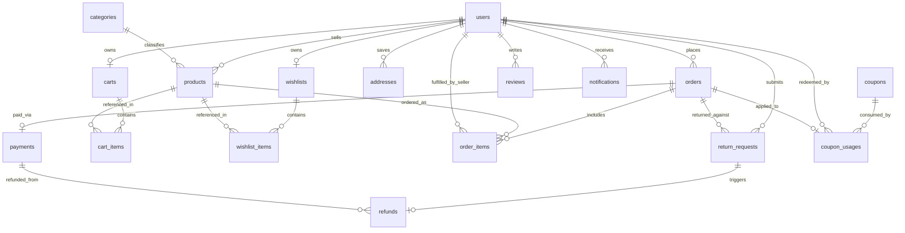

# SHOPIVO — DATABASE ARCHITECTURE & SCHEMA DOCUMENTATION
## Relational Entity Models, Migrations, Constraints & Live Database Audit

---

### Database Infrastructure
- **RDBMS Engine**: PostgreSQL `18.4` (Port `5433`)
- **Database Name**: `securecommerce`
- **Schema Name**: `public`
- **Migration Framework**: Flyway Core `10.x/11.x`
- **Connection Pool**: HikariCP (Max: 10, Min Idle: 5, Timeout: 30,000ms)
- **Total Tables**: 20 (19 Application Business Tables + 1 Flyway Schema History)
- **Live Migration Status**: 19 of 19 Migrations Applied Successfully (`success=true`)

---

## 1. Flyway Migration Inventory (V1 to V19)

| Migration Version | Description | Target Tables / Operations | Semester 1 Role & Purpose | Status |
|---|---|---|---|---|
| **V1** | `create_users_table.sql` | `users` | Core user identity, BCrypt password storage, role enum (`CUSTOMER`, `SELLER`, `ADMIN`). | **Applied** |
| **V2** | `create_categories_and_products.sql` | `categories`, `products` | Product catalog schema, seller ownership FK, category FK, price, stock, status. | **Applied** |
| **V3** | `seed_categories_and_products.sql` | `categories`, `products` | Initial catalog seed data across 6 standard retail categories. | **Applied** |
| **V4** | `create_cart_tables.sql` | `carts`, `cart_items` | Multi-vendor customer shopping basket with unique customer constraint. | **Applied** |
| **V5** | `create_wishlist_tables.sql` | `wishlists`, `wishlist_items` | Customer saved items and favorites tracking. | **Applied** |
| **V6** | `create_addresses_table.sql` | `addresses` | Customer shipping addresses book with default selection flag. | **Applied** |
| **V7** | `create_orders_tables.sql` | `orders`, `order_items` | Atomic transactional orders with immutable address snapshots and line items. | **Applied** |
| **V8** | `create_payments_table.sql` | `payments` | Financial audit ledger, transaction IDs, payment methods, and statuses. | **Applied** |
| **V9** | `add_cancellation_fields_to_orders.sql` | `orders` | Fields for customer/admin cancellation reasons and cancellation timestamps. | **Applied** |
| **V10** | `create_reviews_table.sql` | `reviews` | Customer product reviews with verified purchase enforcement (`uq_customer_product_review`). | **Applied** |
| **V11** | `create_returns_and_refunds_tables.sql` | `return_requests`, `refunds` | Customer return workflow and administrative refund tracking ledger. | **Applied** |
| **V12** | `create_notifications_table.sql` | `notifications` | In-app user notifications for orders, shipments, returns, and system alerts. | **Applied** |
| **V13** | `create_coupons_and_add_order_discount_fields.sql` | `coupons`, `coupon_usages`, `orders` | Promotional discount engine and order-level discount/coupon tracking. | **Applied** |
| **V14** | `add_rejection_reason_to_products.sql` | `products` | Moderation field storing administrative rejection feedback for vendors. | **Applied** |
| **V15** | `demo_seed_data.sql` | Multiple tables | Initial demo seed expansion for showcase testing. | **Applied** |
| **V16** | `production_payment_gateway_and_webhooks.sql` | `payments`, `payment_webhook_events` | Razorpay order IDs, payment IDs, signature verification flags, and webhook deduplication. | **Applied** |
| **V17** | `add_payment_refund_requested_and_refund_lifecycle.sql` | `payments` | Lifecycle status expansion for online refund processing. | **Applied** |
| **V18** | `create_user_events_table.sql` | `user_events` | Passive audit and user interaction event log (Semester 1 foundation). | **Applied** |
| **V19** | `demo_seed_expansion.sql` | Multiple tables | Full demo dataset: 24 customers, 16 sellers (5 showcase), 52 products, 40 orders. | **Applied** |

---

## 2. Entity-Relationship Overview

---

## 3. Detailed Table Schema & Relational Specifications

### 3.1 Table: `users`
- **Purpose**: System identity store supporting multi-tenant role-based access for Customers, Sellers, and Admins.
- **Live Row Count**: `41` (24 CUSTOMER, 16 SELLER, 1 ADMIN)
- **Primary Key**: `id` (BIGSERIAL)
- **Columns**:
  - `id` (BIGINT, PK, Auto-increment)
  - `email` (VARCHAR(255), UNIQUE, NOT NULL)
  - `password_hash` (VARCHAR(255), NOT NULL) — BCrypt hash (cost factor 12)
  - `first_name` (VARCHAR(100), NOT NULL)
  - `last_name` (VARCHAR(100), NOT NULL)
  - `role` (VARCHAR(20), NOT NULL) — `CUSTOMER`, `SELLER`, `ADMIN`
  - `enabled` (BOOLEAN, NOT NULL, DEFAULT true) — Account suspension flag
  - `created_at` (TIMESTAMP WITH TIME ZONE, NOT NULL)
  - `updated_at` (TIMESTAMP WITH TIME ZONE, NOT NULL)
- **Indexes**: `idx_users_email` (UNIQUE), `idx_users_role`

### 3.2 Table: `categories`
- **Purpose**: Taxonomy hierarchy for catalog classification.
- **Live Row Count**: `6`
- **Primary Key**: `id` (BIGSERIAL)
- **Columns**:
  - `id` (BIGINT, PK)
  - `name` (VARCHAR(100), UNIQUE, NOT NULL)
  - `slug` (VARCHAR(120), UNIQUE, NOT NULL)
  - `description` (TEXT)
  - `image_url` (VARCHAR(500))
  - `created_at`, `updated_at` (TIMESTAMP WITH TIME ZONE)

### 3.3 Table: `products`
- **Purpose**: Central product inventory record submitted by sellers and moderated by administrators.
- **Live Row Count**: `52` (36 APPROVED, 12 PENDING, 4 REJECTED)
- **Primary Key**: `id` (BIGSERIAL)
- **Foreign Keys**:
  - `seller_id` REFERENCES `users(id)` ON DELETE RESTRICT
  - `category_id` REFERENCES `categories(id)` ON DELETE SET NULL
- **Columns**:
  - `id` (BIGINT, PK)
  - `seller_id` (BIGINT, NOT NULL, FK)
  - `category_id` (BIGINT, FK)
  - `name` (VARCHAR(255), NOT NULL)
  - `slug` (VARCHAR(280), UNIQUE, NOT NULL)
  - `description` (TEXT)
  - `price` (NUMERIC(12, 2), NOT NULL)
  - `stock_quantity` (INTEGER, NOT NULL, DEFAULT 0)
  - `image_url` (VARCHAR(500))
  - `status` (VARCHAR(20), NOT NULL, DEFAULT 'PENDING') — `PENDING`, `APPROVED`, `REJECTED`
  - `rejection_reason` (VARCHAR(1000)) — Administrative feedback to seller
  - `created_at`, `updated_at` (TIMESTAMP WITH TIME ZONE)
- **Constraints**: `chk_product_price_positive` (price >= 0), `chk_stock_non_negative` (stock_quantity >= 0)

### 3.4 Table: `carts` & `cart_items`
- **Purpose**: Persistent customer shopping carts supporting multi-vendor basket aggregation.
- **Live Row Counts**: `carts`: 7, `cart_items`: 2
- **Foreign Keys**:
  - `carts.customer_id` REFERENCES `users(id)` ON DELETE CASCADE (UNIQUE)
  - `cart_items.cart_id` REFERENCES `carts(id)` ON DELETE CASCADE
  - `cart_items.product_id` REFERENCES `products(id)` ON DELETE RESTRICT
- **Constraints**: `uq_cart_product` on `cart_items(cart_id, product_id)` ensuring single line item per product.

### 3.5 Table: `wishlists` & `wishlist_items`
- **Purpose**: Customer favorite items and saved product lists.
- **Live Row Counts**: `wishlists`: 3, `wishlist_items`: 0
- **Foreign Keys**:
  - `wishlists.customer_id` REFERENCES `users(id)` ON DELETE CASCADE (UNIQUE)
  - `wishlist_items.wishlist_id` REFERENCES `wishlists(id)` ON DELETE CASCADE
  - `wishlist_items.product_id` REFERENCES `products(id)` ON DELETE CASCADE
- **Constraints**: `uq_wishlist_product` on `wishlist_items(wishlist_id, product_id)`.

### 3.6 Table: `addresses`
- **Purpose**: Customer saved delivery address book.
- **Live Row Count**: `18`
- **Foreign Keys**: `customer_id` REFERENCES `users(id)` ON DELETE CASCADE
- **Columns**: `id`, `customer_id`, `full_name`, `phone`, `address_line1`, `address_line2`, `city`, `state`, `postal_code`, `country`, `is_default`, `created_at`, `updated_at`.

### 3.7 Table: `orders`
- **Purpose**: Authoritative commercial transaction record with immutable shipping snapshot and payment window.
- **Live Row Count**: `40` (15 DELIVERED, 9 CONFIRMED, 8 CANCELLED, 6 SHIPPED, 2 PROCESSING)
- **Foreign Keys**: `customer_id` REFERENCES `users(id)` ON DELETE RESTRICT
- **Columns**:
  - `id` (BIGINT, PK)
  - `customer_id` (BIGINT, NOT NULL, FK)
  - `shipping_full_name`, `shipping_phone`, `shipping_line1`, `shipping_line2`, `shipping_city`, `shipping_state`, `shipping_postal_code`, `shipping_country` (Immutable address snapshot)
  - `status` (VARCHAR(30), NOT NULL, DEFAULT 'PENDING') — `PENDING`, `CONFIRMED`, `PROCESSING`, `SHIPPED`, `DELIVERED`, `CANCELLED`
  - `subtotal_amount` (NUMERIC(12, 2))
  - `discount_amount` (NUMERIC(12, 2), DEFAULT 0)
  - `coupon_code` (VARCHAR(50))
  - `total_amount` (NUMERIC(12, 2), NOT NULL)
  - `cancellation_reason` (VARCHAR(255))
  - `cancelled_at` (TIMESTAMP WITH TIME ZONE)
  - `payment_expires_at` (TIMESTAMP WITH TIME ZONE) — 30-minute session expiry window
  - `created_at`, `updated_at` (TIMESTAMP WITH TIME ZONE)

### 3.8 Table: `order_items`
- **Purpose**: Immutable breakdown of products within an order, tagged with vendor ID for multi-seller fulfillment.
- **Live Row Count**: `61`
- **Foreign Keys**:
  - `order_id` REFERENCES `orders(id)` ON DELETE CASCADE
  - `product_id` REFERENCES `products(id)` ON DELETE RESTRICT
  - `seller_id` REFERENCES `users(id)` ON DELETE RESTRICT
- **Columns**: `id`, `order_id`, `product_id`, `seller_id`, `product_name_snapshot`, `price_snapshot`, `quantity`, `line_total`, `created_at`.

### 3.9 Table: `payments`
- **Purpose**: Financial transaction ledger capturing online gateway events, dynamic QR orders, and COD tracking.
- **Live Row Count**: `36` (Breakdown: SUCCESS CARD: 12, SUCCESS UPI: 10, SUCCESS RAZORPAY: 2, INITIATED COD: 4, CANCELLED CARD: 1, CANCELLED UPI: 1, CANCELLED RAZORPAY: 2, REFUNDED CARD: 1, REFUNDED UPI: 1, REFUNDED RAZORPAY: 2)
- **Foreign Keys**:
  - `order_id` REFERENCES `orders(id)` ON DELETE RESTRICT
  - `customer_id` REFERENCES `users(id)` ON DELETE RESTRICT
- **Columns**:
  - `id` (BIGINT, PK)
  - `order_id` (BIGINT, NOT NULL, FK)
  - `customer_id` (BIGINT, NOT NULL, FK)
  - `payment_method` (VARCHAR(30), NOT NULL) — `MOCK_CARD`, `RAZORPAY`, `UPI_QR`, `COD`
  - `gateway_method` (VARCHAR(30)) — `card`, `upi`, `netbanking`
  - `payment_status` (VARCHAR(30), NOT NULL) — `INITIATED`, `SUCCESS`, `FAILED`, `REFUND_REQUESTED`, `REFUND_PROCESSING`, `REFUNDED`
  - `transaction_id` (VARCHAR(100), UNIQUE, NOT NULL)
  - `amount` (NUMERIC(12, 2), NOT NULL)
  - `provider` (VARCHAR(50), NOT NULL, DEFAULT 'RAZORPAY')
  - `provider_order_id` (VARCHAR(100)) — Razorpay Order ID (`order_...`)
  - `provider_payment_id` (VARCHAR(100)) — Razorpay Payment ID (`pay_...`)
  - `provider_signature_verified` (BOOLEAN, NOT NULL, DEFAULT false)
  - `refund_provider_id` (VARCHAR(100)) — Razorpay Refund ID (`rfnd_...`)
  - `card_last4` (VARCHAR(4))
  - `upi_id_snapshot` (VARCHAR(100))
  - `failure_reason` (VARCHAR(255))
  - `created_at`, `updated_at` (TIMESTAMP WITH TIME ZONE)

### 3.10 Table: `payment_webhook_events`
- **Purpose**: Event-level idempotency store preventing duplicate webhook execution and out-of-order state overwrites.
- **Live Row Count**: `0` (Schema verified and tested via MockMvc test suite)
- **Columns**: `id`, `provider`, `event_id` (UNIQUE), `event_type`, `payload` (TEXT), `processing_status`, `error_message`, `created_at`, `processed_at`.

### 3.11 Table: `return_requests` & `refunds`
- **Purpose**: Post-delivery customer returns lifecycle and gateway refund audit ledger.
- **Live Row Counts**: `return_requests`: 4, `refunds`: 4
- **Foreign Keys**:
  - `return_requests.order_id` REFERENCES `orders(id)`
  - `return_requests.customer_id` REFERENCES `users(id)`
  - `refunds.return_id` REFERENCES `return_requests(id)` (One-to-One)
  - `refunds.payment_id` REFERENCES `payments(id)`
- **Columns**:
  - `return_requests`: `id`, `order_id`, `customer_id`, `reason`, `return_note`, `status` (`REQUESTED`, `APPROVED`, `REJECTED`, `COMPLETED`), `refund_amount`, `requested_at`, `approved_at`, `rejected_at`.
  - `refunds`: `id`, `return_id`, `order_id`, `customer_id`, `payment_id`, `refund_amount`, `refund_status` (`PENDING`, `PROCESSED`, `FAILED`), `refund_transaction_id` (UNIQUE), `payment_method`, `processed_at`.

### 3.12 Table: `reviews`
- **Purpose**: Customer feedback and ratings store with verified purchase integrity enforcement.
- **Live Row Count**: `23`
- **Foreign Keys**:
  - `product_id` REFERENCES `products(id)` ON DELETE CASCADE
  - `customer_id` REFERENCES `users(id)` ON DELETE CASCADE
  - `order_id` REFERENCES `orders(id)` ON DELETE RESTRICT
- **Constraints**:
  - `uq_customer_product_review` UNIQUE (`customer_id`, `product_id`) — Enforces maximum one review per product per customer.
  - `chk_rating_range` CHECK (`rating >= 1 AND rating <= 5`).

### 3.13 Table: `coupons` & `coupon_usages`
- **Purpose**: Promotional discount codes with usage limits, validity dates, and minimum order requirements.
- **Live Row Counts**: `coupons`: 3 (`WELCOME10`, `FESTIVE20`, `SAVE500`), `coupon_usages`: 6
- **Foreign Keys**:
  - `coupon_usages.coupon_id` REFERENCES `coupons(id)`
  - `coupon_usages.customer_id` REFERENCES `users(id)`
  - `coupon_usages.order_id` REFERENCES `orders(id)`

### 3.14 Table: `notifications`
- **Purpose**: Real-time customer, seller, and administrator operational alert system.
- **Live Row Count**: `51`
- **Foreign Keys**: `customer_id` REFERENCES `users(id)` ON DELETE CASCADE
- **Columns**: `id`, `customer_id`, `title`, `message`, `type` (`ORDER_PLACED`, `ORDER_CONFIRMED`, `ORDER_SHIPPED`, `ORDER_DELIVERED`, `ORDER_CANCELLED`, `RETURN_REQUESTED`, `RETURN_APPROVED`, `REFUND_SUCCESS`), `reference_type`, `reference_id`, `is_read`, `created_at`.

### 3.15 Table: `user_events`
- **Purpose**: Passive interaction audit and behavioral event recording (Semester 1 foundation).
- **Live Row Count**: `21`
- **Columns**: `id`, `user_id`, `user_email`, `event_type`, `event_timestamp`, `session_id`, `reference_type`, `reference_id`, `ip_address`, `user_agent`, `metadata` (TEXT).

---

## 4. Relational Data Integrity Rules

1. **Integer Paise & BigDecimal Pricing**: Database monetary columns use `NUMERIC(12, 2)`. When communicating with Razorpay, amounts are strictly converted to integer paise (`amount * 100`) to prevent floating-point rounding errors.
2. **Immutable Historical Snapshots**: Line items in `order_items` duplicate the product name and price at the exact moment of order placement. If a seller edits a product's price later, historical orders remain legally accurate and unmodified.
3. **Atomic Stock Decrement**: The checkout process uses transactional database decrements (`stock_quantity = stock_quantity - :qty`) with checking constraints preventing stock from dropping below zero.
4. **Verified Review Constraint**: Database-level unique constraint (`uq_customer_product_review`) combined with service-level checks ensures a customer can only review a product if they have an order in `DELIVERED` status.
5. **Webhook Deduplication**: Webhook events enforce unique constraint on `event_id` in `payment_webhook_events`, guaranteeing that duplicate network deliveries from Razorpay never double-credit or overwrite verified orders.

