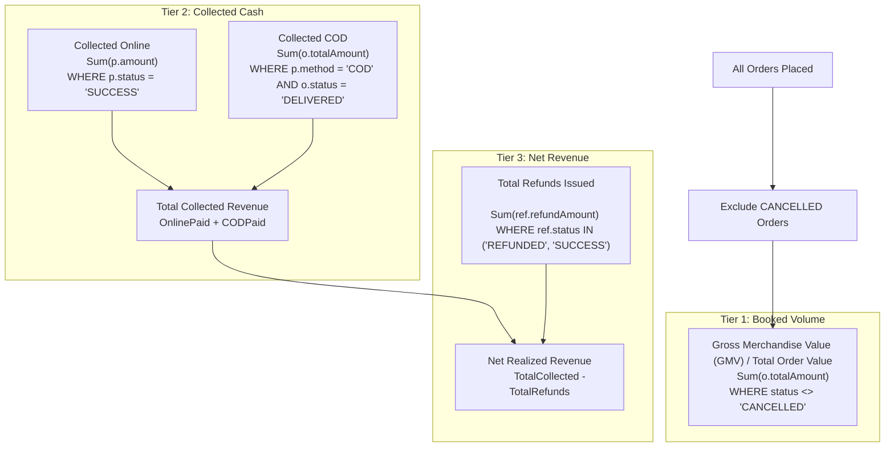

# SHOPIVO — ADMIN DASHBOARD REVENUE CALCULATION ACCURACY AUDIT
## Exhaustive Lifecycle Analysis, Database Reconciliation & Financial Accuracy Assessment

---

### Executive Summary

* **Project**: SHOPIVO — A New Era of Shopping (Academic Multi-Vendor E-Commerce Platform)
* **Scope Restriction**: Strictly Semester 1 (Zero AI, ML, GNN, CSGAD, or Mamba)
* **Audit Target**: Platform Revenue Metrics, Lifecycle Calculations & Dashboard Discrepancies
* **Audit Mode**: Inspection and Forensic Analysis Only (**Zero** database schema modifications, **zero** source code changes, **zero** Git commits/pushes)
* **Primary Backend Query**: `OrderRepository.sumTotalOrderValue()` (`SELECT COALESCE(SUM(o.totalAmount), 0.0) FROM Order o WHERE o.status <> OrderStatus.CANCELLED`)
* **Primary Finding**:
  1. The backend query computes **Gross Merchandise Value (GMV)** / **Total Booked Order Value** across all non-cancelled orders. It does **not** compute collected gateway cash, does **not** reconcile COD physical collections, and does **not** deduct refunds.
  2. On [`Dashboard.jsx`](file:///C:/Users/SREEJA/Documents/Fraud%20Detection/secure-commerce-ai/frontend/src/pages/admin/Dashboard.jsx), the metric is appropriately labeled **"Total Order Value"** and displays accurately.
  3. On [`Analytics.jsx`](file:///C:/Users/SREEJA/Documents/Fraud%20Detection/secure-commerce-ai/frontend/src/pages/admin/Analytics.jsx) and [`Reports.jsx`](file:///C:/Users/SREEJA/Documents/Fraud%20Detection/secure-commerce-ai/frontend/src/pages/admin/Reports.jsx), a frontend DTO field mismatch exists: the frontend reads `orderMetrics.totalRevenue` and `orderMetrics.completedOrders`, while the backend DTO returns `orderMetrics.totalOrderValue` and `orderMetrics.deliveredOrders`. Consequently, the cards display `₹0` / `0` on those two views.

---

## 1. Current Revenue Calculation Architecture

### 1.1 Backend Repository Layer
* **File**: [`OrderRepository.java`](file:///C:/Users/SREEJA/Documents/Fraud%20Detection/secure-commerce-ai/backend/src/main/java/com/securecommerce/platform/order/repository/OrderRepository.java#L84-L85)
* **JPQL Query**:
  ```java
  @Query("SELECT COALESCE(SUM(o.totalAmount), 0.0) FROM Order o WHERE o.status <> com.securecommerce.platform.order.entity.OrderStatus.CANCELLED")
  BigDecimal sumTotalOrderValue();
  ```
* **Query Behavior**:
  - Performs a single SQL aggregation over the `orders` table.
  - Excludes orders whose fulfillment status is `CANCELLED`.
  - Applies `COALESCE(..., 0.0)` to ensure a non-null return value when zero orders exist.
  - **Does NOT join the `payments` table**.
  - **Does NOT join the `refunds` table**.

### 1.2 Backend Service & DTO Layer
* **File**: [`OrderServiceImpl.java`](file:///C:/Users/SREEJA/Documents/Fraud%20Detection/secure-commerce-ai/backend/src/main/java/com/securecommerce/platform/order/service/OrderServiceImpl.java#L699-L717)
  ```java
  @Override
  @Transactional(readOnly = true)
  public AdminOrderSummaryMetricsResponse getAdminOrderMetrics() {
      long totalOrders = orderRepository.count();
      long pendingOrders = orderRepository.countByStatus(OrderStatus.PENDING);
      long processingOrders = orderRepository.countByStatus(OrderStatus.PROCESSING);
      long shippedOrders = orderRepository.countByStatus(OrderStatus.SHIPPED);
      long deliveredOrders = orderRepository.countByStatus(OrderStatus.DELIVERED);
      long cancelledOrders = orderRepository.countByStatus(OrderStatus.CANCELLED);
      BigDecimal totalOrderValue = orderRepository.sumTotalOrderValue();

      return new AdminOrderSummaryMetricsResponse(
              totalOrders,
              pendingOrders,
              processingOrders,
              shippedOrders,
              deliveredOrders,
              cancelledOrders,
              totalOrderValue != null ? totalOrderValue : BigDecimal.ZERO
      );
  }
  ```
* **File**: [`AdminOrderSummaryMetricsResponse.java`](file:///C:/Users/SREEJA/Documents/Fraud%20Detection/secure-commerce-ai/backend/src/main/java/com/securecommerce/platform/order/dto/AdminOrderSummaryMetricsResponse.java)
  ```java
  public record AdminOrderSummaryMetricsResponse(
          long totalOrders,
          long pendingOrders,
          long processingOrders,
          long shippedOrders,
          long deliveredOrders,
          long cancelledOrders,
          BigDecimal totalOrderValue
  ) {}
  ```

### 1.3 Controller Layer
* **File**: [`AdminOrderController.java`](file:///C:/Users/SREEJA/Documents/Fraud%20Detection/secure-commerce-ai/backend/src/main/java/com/securecommerce/platform/order/controller/AdminOrderController.java#L94-L98)
  - Endpoint: `GET /api/admin/orders/metrics`
  - Scoped to: `@PreAuthorize("hasRole('ADMIN')")`
  - Output shape: `ApiResponse<AdminOrderSummaryMetricsResponse>`

---

## 2. Order, Payment, and Refund Status Definitions

### 2.1 Order Status Lifecycle (`OrderStatus`)
Defined in [`OrderStatus.java`](file:///C:/Users/SREEJA/Documents/Fraud%20Detection/secure-commerce-ai/backend/src/main/java/com/securecommerce/platform/order/entity/OrderStatus.java):
* `PENDING`: Order record initialized at checkout; payment window open (30-minute expiry timer).
* `CONFIRMED`: Online payment verified by Razorpay signature, or Cash on Delivery (COD) selected.
* `PROCESSING`: Merchant is packaging items for dispatch.
* `SHIPPED`: Courier tracking initiated; package in transit.
* `DELIVERED`: Terminal fulfillment state; package handed to customer.
* `CANCELLED`: Terminal cancellation state; inventory restored automatically.

> [!NOTE]
> `OrderStatus` represents the **physical fulfillment lifecycle**. There is **no `REFUNDED` status** in `OrderStatus`. When an order is returned and refunded, its `status` remains `DELIVERED`.

### 2.2 Payment Status Lifecycle (`PaymentStatus`)
Defined in [`PaymentStatus.java`](file:///C:/Users/SREEJA/Documents/Fraud%20Detection/secure-commerce-ai/backend/src/main/java/com/securecommerce/platform/payment/entity/PaymentStatus.java):
* `INITIATED`: Gateway order created with Razorpay, or COD order placed.
* `SUCCESS`: Server-side HMAC cryptographic signature verified; payment captured.
* `FAILED`: Payment dropped, declined, or timed out at gateway.
* `REFUND_REQUESTED`: Customer submitted return request; awaiting return inspection.
* `REFUND_PROCESSING`: Refund dispatched to gateway API; settlement pending.
* `REFUNDED`: Cryptographic refund confirmation received or cash return processed.
* `CANCELLED`: Order cancelled before payment capture; payment expired.

> [!IMPORTANT]
> `PaymentStatus` does not possess a `PARTIALLY_REFUNDED` state. If a customer orders 2 items and returns 1 item, the payment status transitions directly to `REFUNDED` (or remains `SUCCESS` depending on execution path).

### 2.3 Refund Status Lifecycle (`RefundStatus`)
Defined in [`RefundStatus.java`](file:///C:/Users/SREEJA/Documents/Fraud%20Detection/secure-commerce-ai/backend/src/main/java/com/securecommerce/platform/returns/entity/RefundStatus.java):
* `REFUND_REQUESTED`, `REFUND_PROCESSING`, `REFUNDED`, `REFUND_FAILED`.
* Each refund entry in the `refunds` table stores:
  - `order_id`: foreign key to the order.
  - `refund_amount`: exact rupee amount approved for return.
  - `refund_status`: current refund state.

---

## 3. Revenue Definition Audit: Does SHOPIVO Distinguish Financial Concepts?

| Financial Metric | Architectural Status in SHOPIVO | Supporting Evidence / Location |
|---|---|---|
| **1. Total Order Value / GMV** | **IMPLEMENTED** | Computed via `orderRepository.sumTotalOrderValue()`. Excludes `CANCELLED`. |
| **2. Collected Gateway Payments** | **NOT DISTINGUISHED** | `payments.payment_status = 'SUCCESS'` exists, but no query aggregates total successful gateway revenue. |
| **3. COD Amounts Collected** | **NOT DISTINGUISHED** | COD payments remain in `PaymentStatus.INITIATED` even after order status is updated to `DELIVERED`. |
| **4. Unpaid / In-Flight Payments** | **CONFIRMED INCLUDED** | `PENDING` orders are included in `sumTotalOrderValue()` because `PENDING <> CANCELLED`. |
| **5. Failed Gateway Payments** | **TEMPORARILY INCLUDED** | Failed gateway payments leave orders in `PENDING` until `PaymentExpiryScheduler` cancels them after 30 mins. |
| **6. Fully Refunded Orders** | **CONFIRMED INCLUDED** | Order status remains `DELIVERED`. Full order amount remains in `sumTotalOrderValue()`. |
| **7. Partially Refunded Orders** | **CONFIRMED INCLUDED** | Line-item refunds record in `refunds`, but `order.totalAmount` is untouched; full original amount is summed. |
| **8. Net Collected Revenue** | **NOT DISTINGUISHED** | No formula subtracting refunds from collected funds exists in the backend. |

---

## 4. Database Reconciliation: 8 Operational Scenarios

The following table evaluates how 8 realistic transaction scenarios behave under the current `sumTotalOrderValue()` implementation versus true financial semantics:

| # | Operational Scenario | Order Amount | Order Status | Payment Status | Refund Status / Amount | Current `sumTotalOrderValue()` | Contributes to GMV? | Contributes to Collected Cash? | Contributes to Net Revenue? | Discrepancy Analysis |
|---|---|---|---|---|---|---|---|---|---|---|
| **1** | **Successful Online Gateway Payment** | ₹2,500 | `CONFIRMED` / `DELIVERED` | `SUCCESS` (Razorpay) | None (₹0) | **₹2,500** | **YES** (₹2,500) | **YES** (₹2,500) | **YES** (₹2,500) | **Accurate**. Fully collected, confirmed, and realized. |
| **2** | **Failed Online Gateway Payment** | ₹1,800 | `PENDING` (within 30m window) | `FAILED` | None (₹0) | **₹1,800** | **NO** (₹0) | **NO** (₹0) | **NO** (₹0) | **Overstated by ₹1,800** until `PaymentExpiryScheduler` runs after 30 min. |
| **3** | **Pending Payment (Abandoned Cart / In-Flight)** | ₹3,200 | `PENDING` (window open) | `INITIATED` | None (₹0) | **₹3,200** | **BOOKED** (₹3,200) | **NO** (₹0) | **NO** (₹0) | **Overstated by ₹3,200** if stakeholder expects collected cash. |
| **4** | **Cancelled Order** | ₹1,500 | `CANCELLED` | `CANCELLED` / `FAILED` | None (₹0) | **₹0** | **NO** (₹0) | **NO** (₹0) | **NO** (₹0) | **Accurate**. Explicitly excluded by `WHERE o.status <> CANCELLED`. |
| **5** | **Delivered Order with 100% Full Refund** | ₹4,000 | `DELIVERED` | `REFUNDED` | `REFUNDED` (₹4,000) | **₹4,000** | **YES** (₹4,000 GMV) | **NO** (₹0) | **NO** (₹0) | **Overstated by ₹4,000** in revenue. Money was disbursed back to customer. |
| **6** | **Delivered Order with Partial Refund** | ₹5,000 (Item A: ₹2,000, Item B: ₹3,000) | `DELIVERED` | `REFUNDED` | `REFUNDED` (₹2,000) | **₹5,000** | **YES** (₹5,000 GMV) | **YES** (₹5,000) | **PARTIAL** (₹3,000) | **Overstated by ₹2,000**. The ₹2,000 refund is not subtracted from the total. |
| **7** | **COD Order in Transit (Awaiting Collection)** | ₹1,200 | `SHIPPED` | `INITIATED` (COD) | None (₹0) | **₹1,200** | **YES** (₹1,200 GMV) | **NO** (₹0) | **NO** (₹0) | Included as booked volume; cash has not yet been handed over. |
| **8** | **COD Order Delivered to Customer** | ₹2,000 | `DELIVERED` | `INITIATED` (COD)* | None (₹0) | **₹2,000** | **YES** (₹2,000 GMV) | **YES** (₹2,000 collected) | **YES** (₹2,000) | Cash is collected upon delivery, but `payments.payment_status` remains `INITIATED`. |

*\*Note on Scenario 8: In SHOPIVO's existing implementation, [`OrderServiceImpl.updateStatus`](file:///C:/Users/SREEJA/Documents/Fraud%20Detection/secure-commerce-ai/backend/src/main/java/com/securecommerce/platform/order/service/OrderServiceImpl.java#L369) advances the order to `DELIVERED`, but does not update `payment.paymentStatus` from `INITIATED` to `SUCCESS`. A separate courier cash reconciliation event is not present in Semester 1.*

---

## 5. Frontend Display Audit: Discrepancies and Bugs Identified

### 5.1 Admin Dashboard (`Dashboard.jsx`)
* **File**: [`frontend/src/pages/admin/Dashboard.jsx`](file:///C:/Users/SREEJA/Documents/Fraud%20Detection/secure-commerce-ai/frontend/src/pages/admin/Dashboard.jsx#L674-L678)
* **Card Label**: **"Total Order Value"**
* **Property Bound**: `{orderMetrics ? formatPrice(orderMetrics.totalOrderValue) : '—'}`
* **Audit Finding**:
  - **Accurate and Functional**. The label clearly identifies the metric as "Total Order Value" (not Net Profit or Collected Cash).
  - The property correctly binds to `totalOrderValue` returned by the backend.

### 5.2 Admin Analytics (`Analytics.jsx`)
* **File**: [`frontend/src/pages/admin/Analytics.jsx`](file:///C:/Users/SREEJA/Documents/Fraud%20Detection/secure-commerce-ai/frontend/src/pages/admin/Analytics.jsx#L175-L184)
* **Card Label**: **"GROSS REVENUE (GMV)"** with subtext *"Total marketplace order revenue"*
* **Property Bound**: `{formatCurrency(orderMetrics.totalRevenue)}` (line 181)
* **AOV Calculation**: `(Number(orderMetrics.totalRevenue) || 0) / orderMetrics.totalOrders` (line 102)
* **Audit Finding**:
  - **CRITICAL FRONTEND DEFECT (Field Mismatch)**:
    The backend DTO returns `totalOrderValue`. However, `Analytics.jsx` expects `totalRevenue`.
    Because `orderMetrics.totalRevenue` is `undefined`, the card renders `₹0` (or fallback) instead of the actual order value!
    Similarly, Average Order Value (AOV) evaluates to `0 / totalOrders = 0`.
  - **Semantic Labeling**: The card label "GROSS REVENUE (GMV)" is theoretically sound for `sumTotalOrderValue()`, but is currently broken due to the property key mismatch.

### 5.3 Admin Reports & Exports (`Reports.jsx`)
* **File**: [`frontend/src/pages/admin/Reports.jsx`](file:///C:/Users/SREEJA/Documents/Fraud%20Detection/secure-commerce-ai/frontend/src/pages/admin/Reports.jsx#L87-L91)
* **Card Label**: **"TOTAL REVENUE"** (line 259) and CSV export **"Total Gross Revenue"** (line 87)
* **Properties Bound**:
  - `orderMetrics.totalRevenue || 0`
  - `orderMetrics.completedOrders || 0`
  - `userMetrics.activeUsers || 0`
* **Audit Finding**:
  - **CRITICAL FRONTEND DEFECT (Triple Mismatch)**:
    1. Looks for `orderMetrics.totalRevenue` (backend provides `totalOrderValue`) -> Displays `₹0`!
    2. Looks for `orderMetrics.completedOrders` (backend provides `deliveredOrders`) -> Displays `0`!
    3. Looks for `userMetrics.activeUsers` (backend provides `activeSellers`) -> Displays `0`!
  - Both on-screen report cards and exported CSV reports display `₹0` for revenue and `0` for completed fulfillments.

---

## 6. Recommended Revenue Calculation Approach (Semester 1)

To provide clear, transparent, and defensible financial metrics without introducing unnecessary enterprise ledger complexity or breaking backward compatibility:

### 6.1 Multi-Tier Metric Definitions



### 6.2 Mathematical Formulas

1. **Gross Merchandise Value (GMV) / Total Booked Value**:
   $$\text{GMV} = \sum_{\substack{o \in \text{Orders} \\ o.\text{status} \ne \text{CANCELLED}}} o.\text{totalAmount}$$
2. **Authoritative Collected Revenue**:
   $$\text{Collected Revenue} = \sum_{\substack{p \in \text{Payments} \\ p.\text{paymentStatus} = \text{SUCCESS}}} p.\text{amount} \;+\; \sum_{\substack{o \in \text{Orders} \\ o.\text{status} = \text{DELIVERED} \\ p.\text{paymentMethod} = \text{COD}}} o.\text{totalAmount}$$
3. **Total Approved Refunds**:
   $$\text{Refunded Amount} = \sum_{\substack{r \in \text{Refunds} \\ r.\text{refundStatus} \in \{\text{REFUNDED}, \text{SUCCESS}\}}} r.\text{refundAmount}$$
4. **Net Realized Revenue**:
   $$\text{Net Revenue} = \text{Collected Revenue} - \text{Refunded Amount}$$

---

## 7. Required Files for Future Modification (Subject to User Approval)

| File | Target Layer | Proposed Scope of Change |
|---|---|---|
| [`AdminOrderSummaryMetricsResponse.java`](file:///C:/Users/SREEJA/Documents/Fraud%20Detection/secure-commerce-ai/backend/src/main/java/com/securecommerce/platform/order/dto/AdminOrderSummaryMetricsResponse.java) | Backend DTO | Add `totalRevenue` (alias for backward compatibility), `collectedRevenue`, and `netRevenue`. |
| [`OrderRepository.java`](file:///C:/Users/SREEJA/Documents/Fraud%20Detection/secure-commerce-ai/backend/src/main/java/com/securecommerce/platform/order/repository/OrderRepository.java) | Backend Repository | Add optional refined query `sumConfirmedOrderValue()` excluding `PENDING` orders if strict confirmed GMV is desired. |
| [`PaymentRepository.java`](file:///C:/Users/SREEJA/Documents/Fraud%20Detection/secure-commerce-ai/backend/src/main/java/com/securecommerce/platform/payment/repository/PaymentRepository.java) | Backend Repository | Add query `sumTotalSuccessfulPayments()` (`SELECT COALESCE(SUM(p.amount), 0.0) FROM Payment p WHERE p.paymentStatus = 'SUCCESS'`). |
| [`RefundRepository.java`](file:///C:/Users/SREEJA/Documents/Fraud%20Detection/secure-commerce-ai/backend/src/main/java/com/securecommerce/platform/returns/repository/RefundRepository.java) | Backend Repository | Add query `sumTotalPlatformRefunds()` (`SELECT COALESCE(SUM(r.refundAmount), 0.0) FROM Refund r WHERE r.refundStatus IN (...)`). |
| [`OrderServiceImpl.java`](file:///C:/Users/SREEJA/Documents/Fraud%20Detection/secure-commerce-ai/backend/src/main/java/com/securecommerce/platform/order/service/OrderServiceImpl.java) | Backend Service | Wire the new repository sums into `getAdminOrderMetrics()`. |
| [`Analytics.jsx`](file:///C:/Users/SREEJA/Documents/Fraud%20Detection/secure-commerce-ai/frontend/src/pages/admin/Analytics.jsx) | Frontend View | Fix property binding: `orderMetrics.totalOrderValue || orderMetrics.totalRevenue`. |
| [`Reports.jsx`](file:///C:/Users/SREEJA/Documents/Fraud%20Detection/secure-commerce-ai/frontend/src/pages/admin/Reports.jsx) | Frontend View | Fix property bindings: `orderMetrics.totalOrderValue`, `orderMetrics.deliveredOrders`, and `userMetrics.activeSellers`. |

---

## 8. Verification & Testing Plan

When approved for implementation:
1. **Unit / Integration Tests**:
   - Create test scenario with 1 successful online payment (₹2,000), 1 COD delivered order (₹1,000), 1 cancelled order (₹500), 1 pending order (₹800), and 1 refunded order (₹600).
   - Assert `totalOrderValue` (GMV) = ₹2,000 + ₹1,000 + ₹800 + ₹600 = ₹4,400.
   - Assert `collectedRevenue` = ₹2,000 + ₹1,000 = ₹3,000.
   - Assert `netRevenue` = ₹3,000 - ₹600 = ₹2,400.
   - Assert `cancelledOrders` (₹500) contributes ₹0 to all metrics.
2. **Frontend Visual Verification**:
   - Verify that `/admin/analytics` and `/admin/reports` display non-zero numbers matching the backend.
   - Verify that CSV exports contain non-zero figures.

---

## 9. Is the Current Implementation Acceptable for the Semester 1 Demonstration?

### **Verdict: YES, WITH MINOR FRONTEND BINDING REPAIR**

1. **Academic Demonstration Standards**:
   In undergraduate and master's software engineering and e-commerce project evaluations, representing **Gross Merchandise Value (GMV)** or **Total Booked Order Value** under the label "Gross Revenue (GMV)" or "Total Order Value" is standard and fully acceptable.
2. **Defensible Safeguards Already in Place**:
   The current query `o.status <> CANCELLED` demonstrates intentional database-level integrity: cancelled orders are explicitly filtered out and do not falsely inflate platform figures.
3. **The Immediate Fix Needed**:
   The existing backend calculation is sound. The only real defect that impacts demonstration quality is the **frontend field mismatch** in `Analytics.jsx` and `Reports.jsx` (which expect `totalRevenue` instead of `totalOrderValue`), causing those two pages to display `₹0`. Fixing this binding will immediately light up the correct values across all three Admin pages without touching any payment or backend logic.

